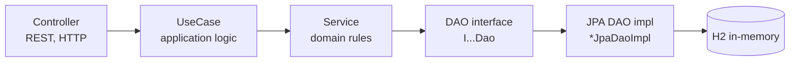

# Taller Spring Security — Course Platform API

A REST API for an online course platform built with **Spring Boot 4**, **Java 25**, **Spring Data JPA** and an in-memory **H2** database.

Instructors publish courses, students enroll in them, and only enrolled students should be able to read paid course content. This repository is the **unsecured baseline**: the authentication and authorization layer is what this project is meant to add, step by step.

> **Status:** The API is intentionally insecure today. Identity comes from an `X-User-Id` header, and every endpoint is public. See [Known limitations](#known-limitations).

## Table of contents

- [Tech stack](#tech-stack)
- [Architecture](#architecture)
- [Components and classes](#components-and-classes)
- [Persistence](#persistence)
- [Messaging](#messaging)
- [Cloud](#cloud)
- [Docker](#docker)
- [Configuration to run](#configuration-to-run)
- [Endpoints](#endpoints)
- [Testing](#testing)
- [Known limitations](#known-limitations)

## Tech stack

| Area | Technology |
|---|---|
| Language | Java 25 |
| Framework | Spring Boot 4.1.1 (Spring MVC, Spring Data JPA) |
| Persistence | H2 in-memory database, Hibernate |
| Mapping | MapStruct 1.6.3 |
| Boilerplate | Lombok |
| Build | Maven (wrapper included) |
| API docs | Postman collection |

## Architecture

The code is organized by feature (`internal/appuser`, `internal/course`), and each feature is split into layers that call only the layer below:



- **Controller:** maps HTTP requests and responses. Reads the requester from the `X-User-Id` header.
- **UseCase:** orchestrates one business operation.
- **Service:** business rules and validation, such as "a course must have an instructor" or "a user cannot enroll twice".
- **DAO:** an interface (`I…Dao`) that hides persistence. The only layer that knows about JPA entities.
- **Mappers:** MapStruct converts between `*Entity` (persistence) and DTOs (API model).

Cross-cutting pieces live in `config/web` (CORS and error handling) and `internal/common/exception` (domain exceptions mapped to HTTP status codes).

## Components and classes

Base package: `com.mx.development.jose.said`

```
com.mx.development.jose.said
├── TallerSpringSecurityApplication          # Spring Boot entry point
├── config/web/
│   ├── AdviceController                     # Global error handling
│   └── CorsConfig                           # CORS configuration (see limitations)
└── internal/
    ├── common/exception/
    │   ├── TallerException                  # Base domain exception
    │   ├── BadRequestException              # HTTP 400
    │   ├── NotFoundException                # HTTP 404
    │   └── ConflictException                # HTTP 409
    ├── appuser/                             # Identity: users and roles
    │   ├── controller/AppUserController
    │   ├── usecase/AppUserUseCase
    │   ├── service/AppUserService
    │   ├── dao/IAppUserDao
    │   ├── dao/jpa/AppUserJpaDaoImpl
    │   └── model/
    │       ├── dto/AppUser                  # API model, includes Role enum
    │       ├── entity/AppUserEntity         # JPA entity
    │       └── mapper/AppUserMapper         # MapStruct
    └── course/                              # Business: courses and enrollments
        ├── controller/CourseController
        ├── usecase/CourseUseCase
        ├── service/CourseService
        ├── dao/ICourseDao
        ├── dao/IEnrollmentDao
        ├── dao/jpa/CourseJpaDaoImpl
        ├── dao/jpa/EnrollmentJpaDaoImpl
        └── model/
            ├── dto/Course, Enrollment
            ├── entity/CourseEntity, EnrollmentEntity
            └── mapper/CourseMapper          # MapStruct
```

### Domain model

| Concept | Description |
|---|---|
| `AppUser` | A person with an email, name, BCrypt password hash, `active` flag and a set of roles (`ROLE_ADMIN`, `ROLE_INSTRUCTOR`, `ROLE_STUDENT`). One user can have several roles. |
| `Course` | A course owned by an instructor. Has a summary (public) and content (intended to be paid). |
| `Enrollment` | Links a student to a course. |

## Persistence

- **Type:** SQL (relational), accessed through JPA/Hibernate.
- **Engine:** H2, in-memory. The schema is created on every start (`ddl-auto=create-drop`) and seeded from `src/main/resources/data.sql`.
- **Tables:** `app_user`, `app_user_role` (element collection for roles), `course`, `enrollment`.
- **Seed data:** 6 users, 3 courses (2 published, 1 draft) and 2 enrollments. Passwords are stored as BCrypt hashes.
- **H2 console:** `http://localhost:8080/h2-console`, JDBC URL `jdbc:h2:mem:taller`, user `sa`, empty password.

Because the database is in memory, all data is lost when the application stops. This is intentional for a workshop and demo.

## Messaging

**Not used.** No broker (Kafka, RabbitMQ, SQS, etc.) and no asynchronous events.

## Cloud

**Not used.** Runs locally. No cloud provider services and no infrastructure as code.

## Docker

**Not used.** There is no `Dockerfile` or `docker-compose.yml` in this repository. The application runs on the host JVM and listens on port `8080`.

| Port | Purpose |
|---|---|
| `8080` | REST API and H2 console (`/h2-console`) |

## Configuration to run

### Requirements

- JDK 25
- No Maven installation needed (use the wrapper `./mvnw`)
- Free port `8080` (or override it)

### Environment variables and properties

This project does not read environment variables. All settings are in `src/main/resources/application.properties`:

| Property | Default | Description |
|---|---|---|
| `spring.application.name` | `taller-spring-security` | Application name |
| `spring.datasource.url` | `jdbc:h2:mem:taller;DB_CLOSE_DELAY=-1` | H2 in-memory database URL |
| `spring.datasource.username` | `sa` | Database user |
| `spring.datasource.password` | *(empty)* | Database password |
| `spring.jpa.hibernate.ddl-auto` | `create-drop` | Schema is created on start and dropped on stop |
| `spring.jpa.open-in-view` | `false` | Disables the open-session-in-view pattern |
| `spring.jpa.defer-datasource-initialization` | `true` | Runs `data.sql` after Hibernate creates the tables |
| `spring.sql.init.mode` | `always` | Always runs the SQL seed file |
| `spring.h2.console.enabled` | `true` | Enables the H2 web console |

Spring profiles: none defined. The project has a single configuration.

### Steps

```bash
# 1. Clone
git clone https://github.com/josesaid/taller-spring-security.git
cd taller-spring-security

# 2. Run (Linux / macOS)
./mvnw spring-boot:run

# Windows
mvnw.cmd spring-boot:run
```

If port `8080` is busy:

```bash
./mvnw spring-boot:run -Dspring-boot.run.arguments=--server.port=8091
```

### Verify it is running

```bash
curl -s http://localhost:8080/course/v1/course
```

You should get a JSON list of published courses.

## Endpoints

All endpoints are public today. The requester is identified by the `X-User-Id` header.

| Method | Path | Description |
|---|---|---|
| `GET` | `/course/v1/course` | List published courses |
| `GET` | `/course/v1/course/{courseId}` | Get one published course |
| `GET` | `/course/v1/course/{courseId}/content` | Get the paid course content |
| `GET` | `/course/v1/course/mine` | Courses the `X-User-Id` user is enrolled in |
| `POST` | `/course/v1/course` | Create a course; the instructor is `X-User-Id` |
| `PUT` | `/course/v1/course/{courseId}` | Update a course |
| `POST` | `/course/v1/course/{courseId}/enroll` | Enroll the `X-User-Id` user (free) |
| `GET` | `/user/v1/user/me` | Profile of the `X-User-Id` user |
| `GET` | `/user/v1/user` | List all users |
| `PUT` | `/user/v1/user/{userId}/roles` | Replace a user's roles |

Example:

```bash
curl -s -H "X-User-Id: 2f1c1a6e-0b4e-4c55-9d0a-6f0e0f6a0002" \
  http://localhost:8080/course/v1/course/mine
```

A Postman collection is available at `postman/taller-spring-security.postman_collection.json` (Postman → Import → File).

### Seed users

| Email | Password | Roles | Notes |
|---|---|---|---|
| `admin@taller.dev` | `admin123` | `ROLE_ADMIN` | |
| `ines@taller.dev` | `user123` | `ROLE_INSTRUCTOR` | Instructor of "Spring Security desde cero" and the draft "Kubernetes" |
| `ivan@taller.dev` | `user123` | `ROLE_INSTRUCTOR`, `ROLE_STUDENT` | Instructor of "Docker para devs", enrolled in Spring Security |
| `student@taller.dev` | `user123` | `ROLE_STUDENT` | Enrolled in Spring Security |
| `newbie@taller.dev` | `user123` | `ROLE_STUDENT` | No enrollments |
| `disabled@taller.dev` | `user123` | `ROLE_STUDENT` | `active = false`, cannot sign in |

These credentials are for local development only.

## Testing

```bash
./mvnw test
```

Current tests:

- `TallerSpringSecurityApplicationTests`: verifies the Spring application context loads.

Not yet covered: service and use case unit tests, controller slice tests, and integration tests against the database.

## Known limitations

These are deliberate in the current state of the project:

- **No authentication.** The `X-User-Id` header is trusted, so anyone can impersonate any user by sending another user's ID.
- **No authorization.** Anyone can read paid content, edit courses they do not own, and grant themselves `ROLE_ADMIN`.
- **Open CORS.** `CorsConfig` allows all origins, methods and headers.
- **Seed credentials in source.** Demo passwords are in `data.sql` and this README.
- **In-memory data.** Data resets on every start.

Planned direction: JWT-based authentication, a `SecurityFilterChain`, role-based and ownership-based rules (`@PreAuthorize`), 401/403 JSON responses, secrets moved out of the code, and security tests.
